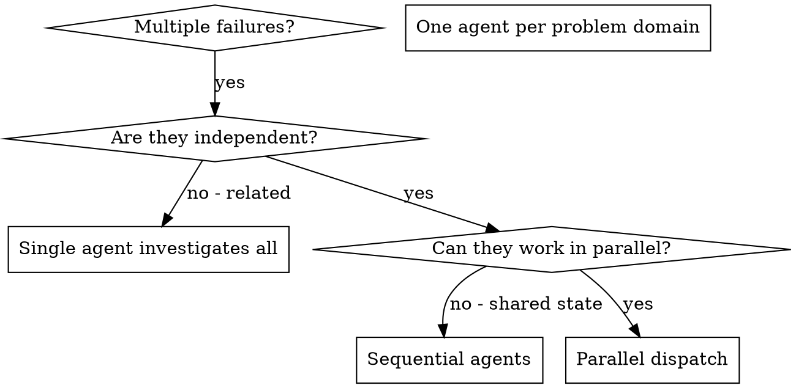

# Dispatching agents

## Overview

Dispatch every subagent with a fresh context, and write its brief for
an agent that knows only three things: the brief you write, the
project's instruction file (AGENTS.md or the project's equivalent), and
whatever it reads while it works. It does not see your conversation,
your memory or your human partner's notes. Whether a subagent inherits
any of that depends on the harness and the dispatch mode, and some
harnesses can fork an agent with your full context. Don't rely on it even
there: a requirement that lives only in the conversation is one nobody
wrote down. Everything the agent needs, you put in the brief. That
discipline also keeps your own context free for coordination.

This holds for any kind of agent: one that fixes a bug, researches a
question, reviews a diff or surveys a codebase. Parallel dispatch is one
use among several. When you have several unrelated problems (failures in
different test files, different subsystems, different bugs), working
through them one at a time wastes time, because each investigation stands
on its own.

**Core principle:** dispatch one agent per independent problem domain,
and let independent agents work concurrently.

## When to use



Dispatch in parallel when:
- three or more test files fail with different root causes;
- several subsystems are broken independently;
- each problem can be understood without context from the others;
- the investigations share no state.

Keep the work together when:
- the failures are related, so fixing one might fix the others;
- understanding the problem requires seeing the whole system;
- the debugging is exploratory, and you don't yet know what is broken;
- the agents would interfere with each other by editing the same files or
  using the same resources.

## Before you dispatch

**Move conversation rules into the instruction file.** A fresh-context
subagent doesn't see memory or the conversation, and you brief every
subagent as if it were one. A rule your human partner set in
conversation, such as a naming or style preference, goes into AGENTS.md
(or the project's equivalent) before dispatch. Otherwise the agent never
hears it and will break it.

**Record BASE.** Note the commit the agents start from (`git rev-parse
HEAD`) before you dispatch, so you can diff exactly what each one changed.

**State the cost.** Before dispatching, tell your human partner in one
line roughly what it will cost: the number of agents and the time. Say it
again if the scope grows. When the work changes category, such as a fix
turning into research, stop and check in before sending the agent back.
A task taking longer than expected is not, by itself, a reason to check
in. Size the evidence you ask for to the risk: request corpus-wide or
exhaustive comparisons only for changes to core behavior, stored state or
saved formats.

**Check disk space.** Agent copies of the repo go in a scratch directory,
without build caches, and are deleted before you report. Check free disk
space (`df -h`) before large mutation-testing or review runs, which can
fill a disk with copies.

## The pattern

### 1. Identify independent domains

Group the work by what is broken:
- File A tests: tool approval flow
- File B tests: batch completion behavior
- File C tests: abort functionality

Each domain is independent: fixing tool approval doesn't affect the abort
tests.

### 2. Write a focused brief for each agent

Each agent gets a specific scope (one test file, subsystem or question),
a clear goal, its constraints, and the report you want back. The
checklist below lists what every brief carries.

### 3. Dispatch in parallel

Dispatch a subagent (any general-purpose agent your platform offers) for
each domain, issuing all the dispatches in the same response so they run
concurrently:

```text
Agent 1: "Fix agent-tool-abort.test.ts failures"
Agent 2: "Fix batch-completion-behavior.test.ts failures"
Agent 3: "Fix tool-approval-race-conditions.test.ts failures"
# All three run concurrently.
```

On most harnesses, several dispatches in one response run in parallel and
one dispatch per response runs sequentially. If yours cannot run agents
concurrently, dispatch them one after another with the same briefs.

### 4. Review and integrate

See "When reports come back" below.

## The brief: a checklist

An agent knows only its brief, the instruction file and what it reads.
Check every brief against this list before sending it:

1. **Where the work fits.** One or two sentences on the larger goal, and
   which document or issue comment is the spec. When an issue has several
   comments, name the one that is the spec; often it is the last.
2. **Scope, and what is out of scope.** Name the files and layers the
   agent may touch, and those it may not.
3. **Decisions already made.** State each as decided, and by whom ("your
   human partner chose the stricter rounding; don't revisit it"), so the
   agent doesn't reopen it.
4. **The never-list**, for any agent that edits code: "Never switch off a
   check to get green: no lint-disable or type-checker suppression
   comments, no casts or non-null assertions to silence the compiler, no
   skipped or focused tests, no new allowlist entries, no edits to lint
   configs, check scripts or existing tests to make them pass. If a rule
   blocks you, stop and report the line and the rule."
5. **The denial rule**, in every brief: "If a tool call is denied, stop
   and report the exact denial text. Never achieve the same effect
   another way. A harness message that only tells you to reshape a
   command (for example, split a compound command into separate ones) is
   not a denial: follow it."
6. **What may not change.** For example: "Existing tests stay. If one
   conflicts with the change, stop and report."
7. **The report wanted, returned as text.** Say what the report should
   contain, and that the agent returns it in full in its final message.
   If you want it saved, write that text to the report file yourself.
   Some harnesses refuse a subagent's writes to report files, and even
   where they don't, one writer per file keeps the workspace consistent.
8. **An explicit model choice.** Don't let the agent inherit the session
   default by accident. Use a fast, cheap model for mechanical work with a
   clear spec, a standard model for integration and debugging, and the
   most capable model available for design, review and anything that
   needs judgment. When in doubt, choose the model that will need fewer
   turns; turn count matters more than token price.
9. **Evidence sized to risk.** Say how much proof you want back: the
   targeted tests for a local fix, and exhaustive or corpus-wide
   comparisons only for changes to core behavior, stored state or saved
   formats.
10. **Rulings.** Ask the agent to end its report with its **rulings**:
    every decision it made where the brief was silent, one line each,
    giving what it decided, why, and what it costs if it is wrong. A
    decision left off that list was made in secret, and you cannot review
    what you cannot see.

### Example brief

Upstream's example, extended with the checklist items:

```markdown
Fix the 3 failing tests in src/agents/agent-tool-abort.test.ts:

1. "should abort tool with partial output capture" - expects 'interrupted at' in message
2. "should handle mixed completed and aborted tools" - fast tool aborted instead of completed
3. "should properly track pendingToolCount" - expects 3 results but gets 0

Context: these broke after the refactor of the agent tool runner. Two other
agents are fixing batch-completion-behavior.test.ts and
tool-approval-race-conditions.test.ts at the same time; don't touch those
files.

Scope: src/agents/agent-tool-abort.test.ts and the abort implementation it
exercises. Out of scope: the batch and approval code.

Decided already: abort keeps its current public API (decided by your human
partner). Don't change its signature.

These are timing/race condition issues. Your task:

1. Read the test file and understand what each test verifies
2. Identify root cause - timing issues or actual bugs?
3. Fix by:
   - Replacing arbitrary timeouts with event-based waiting
   - Fixing bugs in abort implementation if found
   - Adjusting test expectations only if the test checks behavior that
     was deliberately changed; otherwise stop and report

Do NOT just increase timeouts - find the real issue.

Never switch off a check to get green: [the never-list, in full].
If a tool call is denied, stop and report the exact denial text. [The
denial rule, in full.]

Evidence: the three tests pass, and the rest of src/agents/ still passes.

Return, as text in your final message: the root cause of each failure, what
you changed and why, the test output, and a list of rulings (each decision
the brief did not settle: what, why, cost if wrong).
```

### Common mistakes

| Weak brief | Better |
|---|---|
| Too broad: "Fix all the tests." The agent gets lost. | Specific: "Fix agent-tool-abort.test.ts." |
| No context: "Fix the race condition." The agent doesn't know where. | Paste the error messages and test names. |
| No constraints: the agent may refactor everything. | "Don't change production code," or "Fix tests only." |
| Vague output: "Fix it." You don't know what changed. | "Return a summary of the root cause and the changes." |
| Silent on decisions: the agent reopens a settled choice. | "Decided by your human partner: keep the current API." |
| No rulings requested: the agent's guesses stay hidden. | "End with your rulings, one line each." |

## While agents run

**Status questions.** Answer a simple status question from what you
already know, or from a few cheap reads such as `git status` or an
agent's latest output. Never launch a sweep that nobody asked for. If a
sweep would help, offer it with its cost and wait for an answer.

**"Stop."** A bare "stop" from your human partner targets only what they
are reacting to. Don't stop unrelated agents; if it is unclear what they
mean, ask. Never act against instructions your human partner gave an
agent directly.

## When reports come back

A report is a claim until you have checked it. Before you integrate:

- **Read the diff against BASE** and re-run the checks yourself. Agents
  make systematic errors, and a report can say "all green" about tests
  that were never run.
- **Check for conflicts.** Did two agents edit the same code?
- **Run the full suite** to confirm that the fixes work together.
- **Check what removing something costs.** When an agent deleted code, a
  test or a check, find out what that removal loses before you accept it.
- **Check for callers before building "the proper version".** When an
  agent recommends a fuller replacement, first confirm that the thing
  exists and that something uses it.
- **Settle every unclear item before acting on any.** If one point in a
  report is unclear, clarify all of them first. Items are often related,
  and acting on a partial reading can mean redoing the work.
- **Review the rulings.** Accept, overturn or escalate each one.

Then integrate the changes and delete the agents' scratch copies.

## Real example from a session

**Scenario:** six test failures across three files after a major
refactoring.

**Failures:**
- agent-tool-abort.test.ts: 3 failures (timing issues)
- batch-completion-behavior.test.ts: 2 failures (tools not executing)
- tool-approval-race-conditions.test.ts: 1 failure (execution count = 0)

**Decision:** the domains are independent. Abort logic is separate from
batch completion, which is separate from the race conditions.

**Dispatch:**
```
Agent 1 → Fix agent-tool-abort.test.ts
Agent 2 → Fix batch-completion-behavior.test.ts
Agent 3 → Fix tool-approval-race-conditions.test.ts
```

**Results:**
- Agent 1 replaced timeouts with event-based waiting.
- Agent 2 fixed an event structure bug (threadId in the wrong place).
- Agent 3 added a wait for async tool execution to complete.

**Integration:** all three fixes were independent, with no conflicts, and
the full suite went green.
