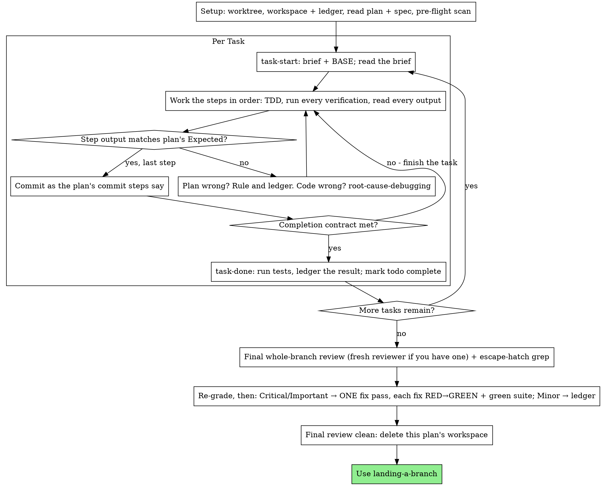

# Inline Plan Execution

Execute the plan yourself, task by task, in this session. No implementer
subagent works on each task and no reviewer checks each one. A single
reviewer with a fresh context reads the whole branch at the end.

Subagent-driven execution pays for a fresh implementer and a fresh
reviewer on every task, and each of them re-reads the codebase from
nothing. Inline execution pays for one context (yours) and one reviewer
at the end. It gives up a fresh context and a second reader on every
task. This skill recovers what those bought by other means: the brief is
the spec, the ledger is your memory, test-first is the gate on each task,
and the final reviewer is the second reader.

**Core principle:** The plan already did the thinking. Execute it
exactly, prove each step with a test you watched fail and then pass, and
leave a record that will outlast your own memory of the session.

Between tool calls, narrate at most one short line. The ledger and the
tool results carry the record.

**Dependencies.** This skill's scripts are self-contained: `scripts/`
carries its own copies of the workspace, brief and review-package helpers,
identical to subagent-plan-execution's. The final review uses
requesting-review's `code-reviewer.md`, and the steps below load
test-first, verify-before-claiming, root-cause-debugging,
isolated-workspaces and landing-a-branch by name. Install those skills
alongside this one. If requesting-review is missing, say so to your human
partner before the final review rather than improvising a reviewer brief.

Do not stop to check in with your human partner between tasks. They
chose inline execution to spend less, and asking "should I continue?"
after every task spends their time instead. Run every task in the plan
without pausing.

## Rulings, not stalls

Decide conflicts, ambiguities and plan defects yourself. The spec is the
binding authority, the plan is the argument built on it, and your
judgment settles whatever neither answers. Record every decision in the
ledger as `Ruling: <what you decided> — <why> — <what it costs if wrong>`,
and keep going. A departure from the plan with no ruling in the ledger is
a decision your human partner never gets to see.

Six things stop you, and only these. For each, stop and ask your human
partner.

- An irreversible or destructive operation.
- A security-sensitive action.
- A side effect outside this worktree that norms say you ask about first,
  such as a merge, a push to a shared branch or a publish.
- A plan so broken that every path forward is a guess.
- **A product decision the spec does not settle:** a choice a user of the
  software would recognize and could disagree with, such as a threshold,
  a default or a behavior on an unforeseen input. Coding practice is not
  in this class: rule on it, and take the stricter option.
- **A project rule that blocks the work.** Report the rule and the line.
  Do not rule your way around it.

If a tool call is denied, stop and report the exact denial text. Never
achieve the same effect another way. A harness message that only tells
you to reshape a command (for example, split a compound command into
separate ones) is not a denial: follow it.

## When to Use

- You have a plan from implementation-planning, and your human
  partner chose inline execution at the handoff.
- Your harness has no subagent tool (see the per-platform references in
  superpowers' `using-superpowers`). Never fake a dispatch; run the plan
  here.
- The tasks are mostly independent. This is the same precondition as
  subagent-plan-execution.

With a fully specified plan, inline execution is transcription plus
testing. It runs well on a mid-tier model. The one place the most capable
model earns its cost is the final review, which this skill dispatches
separately. Tell your human partner this when they choose inline.

Prefer subagent-plan-execution when your human partner wants a review
gate on every task, or when the plan is long enough that its later tasks
would run on a compacted context. Inline execution of a long plan still
works, because the ledger makes it recoverable, but the last tasks get
the least of your attention.

## The Process



## Setup

Work in an isolated workspace: use isolated-workspaces to create one or
to verify the one you are in. Never start implementation on a main or
master branch without your human partner's explicit consent.

Take a snapshot of `git status --short` now and save it to the plan's
workspace (below) as `status-at-start.txt`. At every commit you compare
against it, so that your human partner's own untracked files are left
alone.

Confirm that your human partner was given a rough cost at the handoff
(time, agent dispatches and tokens), beside the execution choice. If
they were not, estimate it now: time, agent dispatches and total tokens.
If the spend is substantial, meaning one your human partner would notice
(by 2026 prices, more than about 500,000 tokens or more than about ten
agent dispatches; revise these figures as prices change), state it and
wait for a yes before Task 1. Otherwise state it, note it in the ledger
and continue. After that, check in again only when the work changes
category: a fix turning into research, or a task turning into a study.
Never check in merely because a task is taking longer than expected.
Size evidence to risk: run corpus-wide or exhaustive comparisons only
for changes to core behavior, stored state or saved formats.

### Where the spec and plan live

This is set per project. Read AGENTS.md, or the project's equivalent
instruction file, for a line such as `Plans: docs/plans/` or
`Plans: issues`.

- If it names a directory, the plan is a committed file there.
- If it says `issues`, or says nothing:
  - The spec is the issue. Name the comment that is the spec; often it is
    the last one.
  - The plan is a working file at `.superpowers/plans/<issue>-<slug>.md`,
    kept out of git by `printf '*\n' > .superpowers/plans/.gitignore`.
  - Decisions that must outlive the branch go in the issue, not the plan.
  - The plan file outlives the workspace: landing-a-branch deletes it
    when the branch lands.

### The workspace and the ledger

Conversation memory does not survive compaction. An inline executor that
loses its place re-implements tasks whose commits already exist. That is
the same failure as a controller dispatching them again, paid for in your
own context. So track progress in a ledger file as well as in any todo
list your harness offers. Todos are a live view; the ledger is the
record.

The workspace and ledger are shared with subagent-plan-execution, in the
same directory and the same format, so a plan can switch executors
midway and the new one resumes from the same ledger.

- Each plan owns a workspace. At skill start, run this skill's
  `scripts/sdd-workspace PLAN_FILE`. It prints
  the plan's git-ignored directory
  (`<repo-root>/.superpowers/sdd/<plan-basename>/`), which holds every
  artifact for this plan: ledger, briefs and review packages. Another
  plan's directory is never yours to read or write.
- Look for this plan's ledger at `<workspace>/progress.md`. If its first
  line names your plan file, every task with a `Task <N>: complete` line
  is done. Do not redo it; resume at the first task without one. Those
  commits exist in git even when your context no longer remembers making
  them, so after compaction, trust the ledger and `git log` over your own
  recollection. A ledger whose first line names a different plan file
  records another plan's progress. Leave it alone and start your own.
- Create the ledger with its identity as the first line:
  `# SDD ledger — plan: <plan file path>`.
- `git clean -fdx` destroys the workspace, because it is git-ignored
  scratch. If that happens, recover from `git log`.

### Read the plan

Read the plan once, note its context and Global Constraints, and make a
todo for each task. If the plan names a spec, read that too. The spec is
the authority the plan argues from, and conflicts inside the plan are
resolved against it. If no spec can be found, write a ledger note saying
so; rulings made without one are provisional.

**REQUIRED SUB-SKILL:** Load test-first now, before Task 1. It governs
every step of every task below. A plan whose steps already say "write
the failing test first" does not excuse you from reading it.

Before Task 1, scan the plan for conflicts between tasks. The plan's
Interfaces blocks show where to look. For every task that consumes what
an earlier task produces, write one ledger row: the two tasks, what one
produces set against what the other consumes, and what you found. Tasks
that share nothing get no row, and a plan whose tasks share nothing gets
the single line `Pre-flight: no shared interfaces`. Rule on each conflict
a row turns up, with the spec as the binding authority, record the ruling
beside its row, and start Task 1. You check each task's own text when you
read its brief, not here.

## The Task Loop

Everything you print, and every tool result, stays in your context for
the rest of the session. Redirect long test output to a file in the
workspace and read its tail. Read a task's brief rather than the whole
plan.

### 1. Take the task

- Run this skill's `scripts/task-start PLAN_FILE N`. In one call it
  prints the brief's path and BASE, the commit the task's range is cut
  from. The brief opens with the plan's Global Constraints, verbatim, and
  then the task's own text; both bind the task. If task-start fails
  because the plan's constraints heading cannot be parsed, fix the
  heading in the plan (a ruling, in the ledger) and run it again. Read
  the brief for every task, including tasks you remember from
  setup. What you remember is a summary; the brief has the exact values,
  signatures and test cases.
- Mark the task's todo in progress.

Every tool call is a turn that re-reads your whole context, so
bookkeeping travels with work. Append to the ledger in the same call as
the commit, never in a call of its own.

### 2. Work the steps

The plan's steps are already in RED-GREEN order. Follow them in that
order under test-first, which you loaded at setup. A test step's code is
written first and run first. Watching it fail is a real step: a test that
passes before the implementation exists tells you something is wrong with
the test.

You are your own implementer here, so the rules a dispatched implementer
would get apply to you. Never switch off a check to get green: no
lint-disable or type-checker suppression comments, no casts or non-null
assertions to silence the compiler, no skipped or focused tests, no new
allowlist entries, no edits to lint configs, check scripts or existing
tests to make them pass. If a rule blocks you, stop and report the line
and the rule.

Every step that runs a command has an `Expected:` line. Run the command,
read its output and compare. There are three outcomes.

- **It matches.** Go to the next step.
- **The code is wrong.** Use root-cause-debugging. Find the cause; never
  patch the symptom so that the output matches.
- **The plan is wrong.** A step contradicts the spec, an interface from
  an earlier task does not match what this task consumes, or a command
  cannot work. Rule on the smallest change that satisfies the spec,
  ledger it as `Task <N>: Ruling: <finding> — <what you decided and why>`,
  and continue. The ledger carries the ruling forward: later tasks that
  touch the same interface read it there instead of relying on your
  memory.

Commit as the plan's commit steps say. A task may span several commits;
BASE is what the review range is cut from, never `HEAD~1`.

Stage files by explicit path. Never stage a directory. Before each
commit, compare `git status --short` with `status-at-start.txt`, so the
user's own untracked files are left alone.

### 3. The completion contract

Before a task gets its ledger line, all of the following must be true,
with evidence from this session. Inferring them from a diff that looks
right does not count.

- Every test the brief names exists and ran in this task, and you read
  the output.
- The task's final test run passed. `task-done` is that run, and it
  writes the command and the result into the ledger line.
- Every `Expected:` line in the brief was compared against real output.
- Every departure from the brief has a `Ruling:` line in the ledger.

**REQUIRED SUB-SKILL:** verify-before-claiming governs the claim. If any
item is missing, the task is not complete: finish it.

### 4. Complete the task

Run this skill's `scripts/task-done PLAN_FILE N BASE -- <test command>`
with the test command the brief names for the whole task. It runs the
tests, keeps the full output in the workspace, prints the tail and, only
if the tests pass, appends the completion line to the ledger:

`Task <N>: complete (commits <base7>..<head7>, tests: <command> → <result>)`

A failing run records nothing, and the task is not complete. Once the
line is recorded, mark the todo complete and take the next task.

## Final Review

Run this skill's `scripts/review-package PLAN_FILE MERGE_BASE HEAD`
(MERGE_BASE is the commit the branch started from, for example
`git merge-base main HEAD`) and review from the file it prints.

**With a subagent tool:** dispatch the reviewer on the most capable model
available, because the whole-branch review is a judgment task. Use
requesting-review's [code-reviewer.md](../requesting-review/code-reviewer.md)
and give it:

- the package path, and the plan and spec paths;
- the plan's Review Focus section verbatim, if it has one (the input
  classes and failure modes the plan's tests do not exercise, which the
  reviewer checks one by one);
- a pointer to the ledger's `Ruling:` lines, so it can weigh the calls
  you made.

Name the model explicitly. A dispatch that omits it inherits the
session's model, which may not be the most capable. This review is the
one fresh context the whole run buys, so dispatch it fresh. If your
harness can fork an agent with this session's history, don't: a fork
carries your blind spots along with your context. Do not skip the review,
and do not replace it with your own read of the diff.

**Without a subagent tool:** read code-reviewer.md and perform that
review yourself against the package, as a separate pass after the last
task's ledger line. Write `Final review: self-review (no subagent tool)`
to the ledger and say so in your final message. A self-review by the
author is weaker than a fresh reviewer, and your human partner decides
whether it is enough before merge.

### Escape-hatch grep

Whoever reviews, run this yourself over the whole branch. It lists, for
your human partner, every place where a check may have been switched off:

```bash
git diff -U0 MERGE_BASE HEAD | grep -nE '^\+.*(eslint-disable|@ts-(ignore|expect-error|nocheck)|noqa|type: *ignore|nolint|NOLINT|@Suppress|#\[allow|\bas any\b|\bas unknown\b|\.(skip|only)\(|\b(xit|fit|xdescribe|fdescribe)\()'
git diff --name-status MERGE_BASE HEAD
```

From the first command, take every added line with a directive comment,
a cast, or a skipped or focused test. From the second, take every changed
lint or type-checker config, check script or allowlist, and every
existing test that was modified (`M`) rather than added (`A`). Extend the
pattern for the project's languages. Each hit goes under "Escape hatches"
in your final message, with its file and line, including the ones you
believe are justified. If there are none, say so. Your human partner
decides; you do not.

### Sorting the findings

Sort the findings before you act on any of them. The reviewer's severity
labels are advice; the gate is yours. Its "Declined to judge" list is
yours as well. Every line on it is a ruling you make and ledger, exactly
as you would a plan conflict: `Final: Ruling: <behavior the reviewer set
aside> — <what a reasonable person using this software gets, and why that
stands or why it is now a finding> — <cost if wrong>`.

Re-grade first, by effect. The spec is a vision document. A finding's
grade is what a reasonable person using this software gets if it ships,
whether or not the spec names the input that triggers it. A reviewer who
rated a finding Minor because the spec was silent has graded the spec,
not the effect. Then:

- **Critical and Important** findings enter the fix pass.
- **Minor** findings go to the ledger as
  `Final: minor (deferred): <one-liner>` and to your final message under
  "Deferred minors". Minors never enter the fix pass and never become
  rulings. A ruling decides a conflict; declining a polish suggestion is
  not one.

### The fix pass

Fix the Critical and Important findings yourself, since you are the
implementer, in one pass. The never-list above still holds. Test-first
verifies each fix, not a second reviewer: write the test that reproduces
the finding, watch it fail, make it pass, then run the whole suite.
Record each fix in the ledger as
`Final: fixed <finding> — <test name> RED→GREEN, suite <N>/<N>`. A fix
without a test that failed first is not verified, and the pass is not
over until the suite is green. Do not dispatch a re-review. It would
re-read a diff whose covering tests already show the findings addressed
and whose suite run already shows nothing broke.

A finding you decide not to fix is a ruling,
`Final: Ruling: <finding> — <why the code stands> — <cost if wrong>`,
and it reaches your human partner in the rulings list. There is no second
fix pass.

## Finish

Before you delete anything, gather into your final message:

- under "Rulings I made", every ledger line containing `Ruling:`, in the
  order you made them, each with what it costs if wrong;
- under "Deferred minors", every `minor (deferred)` line;
- under "Escape hatches", every hit from the escape-hatch grep, or
  "none".

All three lists are exhaustive. Your final message is the only place
where your human partner learns the decisions you took on their behalf
and the findings you chose not to act on.

When the final review is clean and its fixes are committed, delete this
plan's workspace directory; the git history is the record now. Sibling
directories belong to other plans, so leave them alone.

Use landing-a-branch.

## Common Rationalizations

| Excuse | Reality |
|--------|---------|
| "I remember what Task N says" | You remember a summary. The brief has the exact values. Read it. |
| "The plan's code is right, skip watching the test fail" | A test you never saw fail proves nothing. It is one step. Run it. |
| "I'll run the full suite at the end instead of per step" | Per-step runs are how you learn which step broke it. The end-of-task run is the contract, not a substitute. |
| "The plan is wrong here, I'll just do the right thing" | Do the right thing and ledger the ruling. Unledgered deviation is a decision made in secret. |
| "I'll write the ledger lines after a few tasks" | Compaction does not wait for a convenient moment. One line per task, in the same message as the commit. |
| "Let me check in before the next task" | They chose inline to spend less. Progress prompts spend their time instead. Only the six stops stop you. |
| "This one suppression comment is harmless" | You are the implementer; the never-list binds you. Stop and report the line and the rule. |
| "I read my own diff carefully; the final reviewer is redundant" | Same author, same blind spots. The reviewer is the only fresh context this run buys. |
| "Tests should pass, the change was trivial" | "Should" is not evidence. The contract requires the command and its output. |
| "Subagents are slow and expensive, I'll skip the final review too" | Inline already removed the per-task reviewers. One review of the whole branch is the floor, not the ceiling. |
| "The reviewer said Minor, so it's Minor" | The label graded the spec's silence. Grade what the person gets. Re-grade, then gate. |
| "The fix is obvious, no need for a failing test first" | The failing test is the only proof the finding was real and is now gone. Without it you have a diff and a hope. |
| "I'll fix the minors too while I'm in there" | Every minor you fix is a test, a fix, and a suite run your partner did not ask for. Ledger them; your partner decides. |
