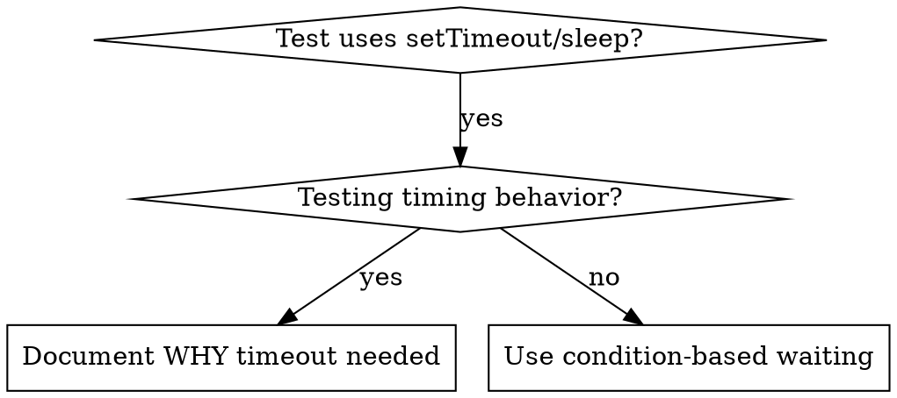

# Condition-Based Waiting

## Overview

Tests that guess at timing with arbitrary delays create race
conditions. They pass on a fast machine and fail under load or in CI.

Wait for the condition you actually care about, not for a guess at how
long it takes.

## When to Use



Use it when:
- tests have arbitrary delays (`setTimeout`, `sleep`, `time.sleep()`);
- tests are intermittent, passing sometimes and failing under load;
- tests time out when run in parallel;
- a test waits for an async operation to complete.

Don't use it when you are testing actual timing behavior, such as a
debounce or throttle interval. If you do use an arbitrary timeout,
document why.

A guessed delay is one cause of intermittent failures, not the only
one. If the failure moves between tests, look for shared state first;
see "There Is No Such Thing as a Flake" in [SKILL.md](SKILL.md).

## Core Pattern

```typescript
// Before: Guessing at timing
await new Promise(r => setTimeout(r, 50));
const result = getResult();
expect(result).toBeDefined();

// After: Waiting for condition
await waitFor(() => getResult() !== undefined);
const result = getResult();
expect(result).toBeDefined();
```

## Quick Patterns

| Scenario | Pattern |
|----------|---------|
| Wait for event | `waitFor(() => events.find(e => e.type === 'DONE'))` |
| Wait for state | `waitFor(() => machine.state === 'ready')` |
| Wait for count | `waitFor(() => items.length >= 5)` |
| Wait for file | `waitFor(() => fs.existsSync(path))` |
| Complex condition | `waitFor(() => obj.ready && obj.value > 10)` |

## Implementation

A generic polling function:
```typescript
async function waitFor<T>(
  condition: () => T | undefined | null | false,
  description: string,
  timeoutMs = 5000
): Promise<T> {
  const startTime = Date.now();

  while (true) {
    const result = condition();
    if (result) return result;

    if (Date.now() - startTime > timeoutMs) {
      throw new Error(`Timeout waiting for ${description} after ${timeoutMs}ms`);
    }

    await new Promise(r => setTimeout(r, 10)); // Poll every 10ms
  }
}
```

[condition-based-waiting-example.ts](condition-based-waiting-example.ts)
in this directory has a complete implementation from a real debugging
session, with domain-specific helpers (`waitForEvent`,
`waitForEventCount`, `waitForEventMatch`).

## Common Mistakes

- **Polling too fast.** `setTimeout(check, 1)` wastes CPU. Poll every
  10ms.
- **No timeout.** The loop runs forever if the condition is never met.
  Always include a timeout with a clear error.
- **Stale data.** Caching state before the loop means the loop never
  sees a change. Call the getter inside the loop.

## When an Arbitrary Timeout Is Correct

```typescript
// Tool ticks every 100ms - need 2 ticks to verify partial output
await waitForEvent(manager, 'TOOL_STARTED'); // First: wait for condition
await new Promise(r => setTimeout(r, 200));   // Then: wait for timed behavior
// 200ms = 2 ticks at 100ms intervals - documented and justified
```

Requirements:
1. Wait for the triggering condition first.
2. Base the delay on known timing, not a guess.
3. Add a comment explaining why.

## Real-World Impact

In the debugging session behind this technique (2025-10-03), this
pattern fixed 15 intermittent tests across 3 files. The pass rate went
from 60% to 100%, and the tests ran 40% faster.
