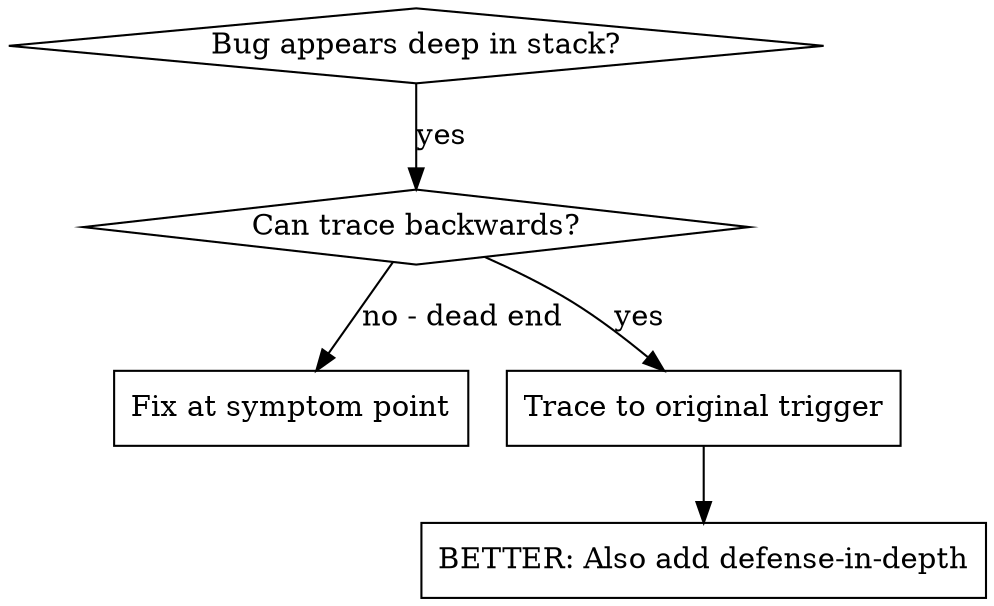
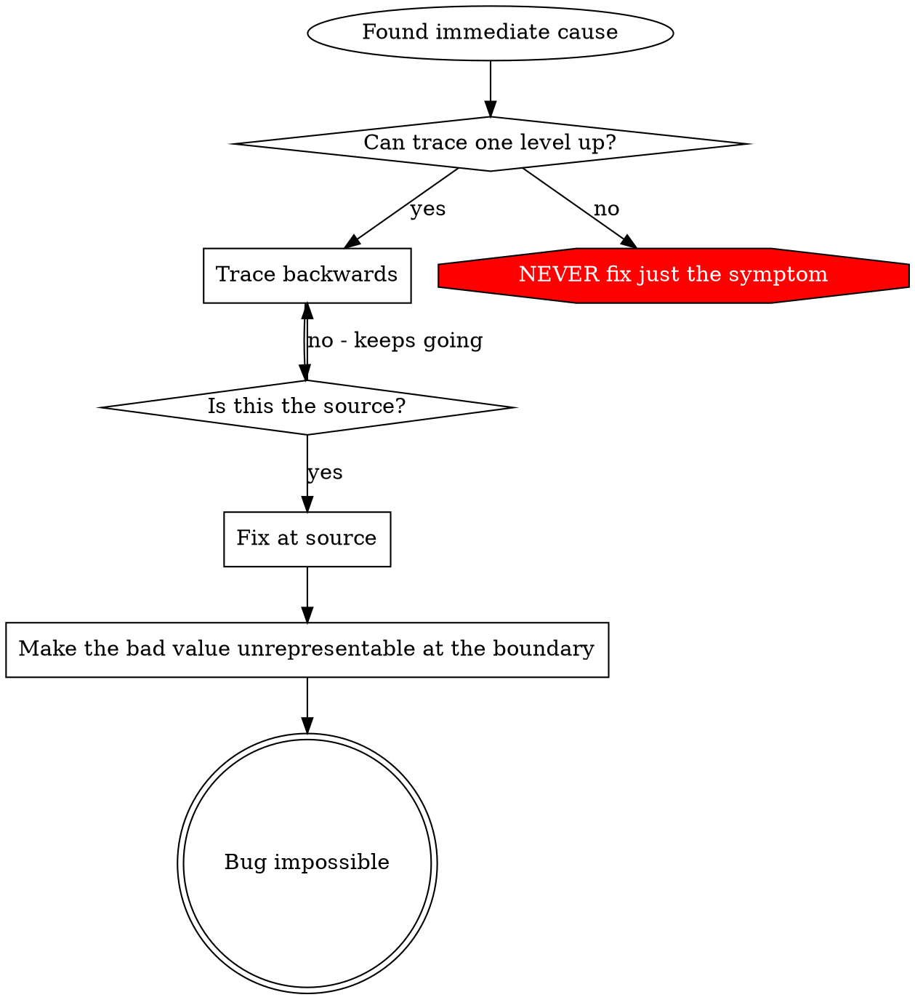

# Root Cause Tracing

## Overview

Bugs often show up deep in the call stack: `git init` in the wrong
directory, a file created in the wrong place, a database opened with the
wrong path. The instinct is to fix the code where the error appears, but
that treats a symptom.

Trace backward through the call chain until you find the original
trigger, then fix it there.

## When to Use



Use it when:
- the error happens deep in execution, not at the entry point;
- the stack trace shows a long call chain;
- it is unclear where the invalid data came from;
- you need to find which test or code path triggers the problem.

## The Tracing Process

### 1. Observe the symptom
```
Error: git init failed in ~/project/packages/core
```

### 2. Find the immediate cause
What code directly causes this?
```typescript
await execFileAsync('git', ['init'], { cwd: projectDir });
```

### 3. Ask what called it
```typescript
WorktreeManager.createSessionWorktree(projectDir, sessionId)
  → called by Session.initializeWorkspace()
  → called by Session.create()
  → called by test at Project.create()
```

### 4. Keep tracing up
What value was passed?
- `projectDir = ''`, an empty string.
- An empty string as `cwd` resolves to `process.cwd()`.
- That is the source code directory.

### 5. Find the original trigger
Where did the empty string come from?
```typescript
const context = setupCoreTest(); // Returns { tempDir: '' }
Project.create('name', context.tempDir); // Accessed before beforeEach!
```

## Adding Stack Traces

When you can't trace by reading, add instrumentation:

```typescript
// Before the problematic operation
async function gitInit(directory: string) {
  const stack = new Error().stack;
  console.error('DEBUG git init:', {
    directory,
    cwd: process.cwd(),
    nodeEnv: process.env.NODE_ENV,
    stack,
  });

  await execFileAsync('git', ['init'], { cwd: directory });
}
```

In tests, use `console.error()` rather than the logger, which may be
suppressed.

Run and capture:
```bash
npm test 2>&1 | grep 'DEBUG git init'
```

Then read the stack traces:
- look for test file names;
- find the line that triggers the call;
- look for a pattern: the same test, the same parameter.

## Finding Which Test Causes Pollution

If something appears during the test run and you don't know which test
creates it, use the bisection script [find-polluter.sh](find-polluter.sh)
in this directory:

```bash
bash ./find-polluter.sh '.git' 'src/**/*.test.ts'
```

It runs the test files one at a time with `npm test` and stops at the
first polluter. It refuses to start, with exit status 2, when no files
match the pattern or the pollution is already present, since either
would make every result meaningless. If any test command fails and no
polluter turns up, it exits 3 and reports the search as inconclusive:
a failed run may stop before the code that pollutes. Exit 0 means every
candidate ran, passed and left nothing behind; the final line says how
many ran. See the script header for details.

## Real Example: Empty projectDir

**Symptom:** `.git` created in `packages/core/`, the source code.

**Trace chain:**
1. `git init` runs in `process.cwd()` because of an empty `cwd`
   parameter.
2. WorktreeManager was called with an empty projectDir.
3. Session.create() passed the empty string.
4. The test accessed `context.tempDir` before `beforeEach`.
5. setupCoreTest() returns `{ tempDir: '' }` initially.

**Root cause:** a top-level variable initialization read a value before
it was set.

**Fix:** `tempDir` became a getter that throws if it is accessed before
`beforeEach`.

**Defense in depth, added afterward** (see
[defense-in-depth.md](defense-in-depth.md)):
- `Project.create()` parses its argument into a `ProjectDir` type that
  cannot be empty, and the inner layers take that type instead of
  re-checking a string.
- An environment guard refuses `git init` outside the temp directory
  during tests.
- `gitInit` logs a stack trace before it runs.

## Key Principle



Don't fix only the place where the error appears. Trace back to the
original trigger.

## Stack Trace Tips

- **In tests:** use `console.error()`, not the logger, which may be
  suppressed.
- **Before the operation:** log before the dangerous operation, not
  after it fails.
- **Include context:** directory, cwd, environment variables,
  timestamps.
- **Capture the stack:** `new Error().stack` shows the complete call
  chain.

## Real-World Impact

In the debugging session behind this technique (2025-10-03), a
five-level trace found the root cause, the fix went in at the source,
and all 1847 tests passed with no pollution.
