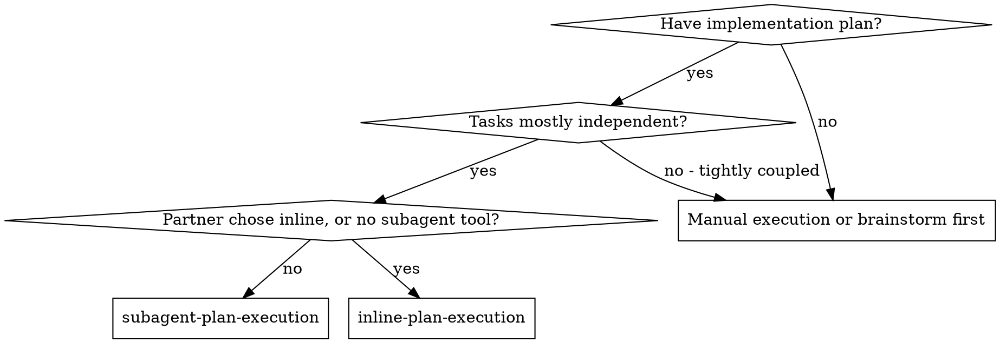
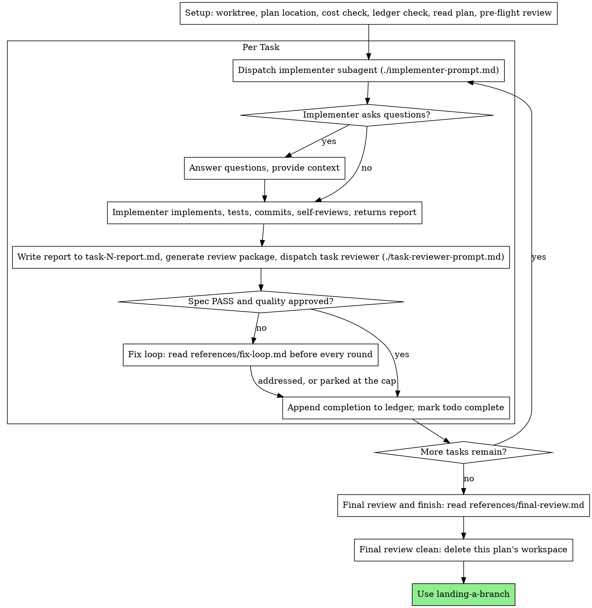

# Subagent plan execution

Execute a plan by dispatching a fresh implementer subagent for each task,
then a task review (spec compliance and code quality) after each one,
then one broad review of the whole branch at the end.

Dispatch each subagent with a fresh context, not one that inherits your
session's history, even where your harness offers inheritance. You give
it exactly what its task needs, which keeps it focused and keeps your own
context free for coordination. Between tool calls, narrate at most one
short line; the ledger and the tool results carry the record.

**Continuous execution.** Don't pause between tasks to check in with your
human partner. Run every task in the plan, and stop only for one of the
stop conditions below or when all tasks are complete. They asked you to
execute the plan, and "Should I continue?" prompts and progress summaries
spend their time without telling them anything they need. Check in again
only when the work changes category: a fix turning into research, or a
task turning into a study. Never check in merely because a task is taking
longer than expected.

**Rulings, not stalls.** A running plan doesn't wait on a human.
Conflicts, ambiguities, plan defects, a cap you would have asked to
exceed: decide them. The spec is the binding authority, the plan is its
argument, and your judgment settles what neither answers. Record every
decision in the ledger as
`Ruling: <what you decided> — <why> — <what it costs if wrong>`, and keep
going. Your human partner can see a wrong ruling and undo it; a session
parked on a question costs them the whole day and buys nothing.

These stop you, and only these. For each, stop and ask:

- an irreversible or destructive operation;
- a security-sensitive action;
- a side effect outside this worktree that norms say you ask about first
  (a merge, a push to a shared branch, a publish);
- a plan so broken that every path forward is a guess;
- **a product decision the spec does not settle:** a choice a user of the
  software would recognize and could disagree with, such as a threshold,
  a default or a behavior on an unforeseen input. Coding practice is not
  in this class: rule on it and take the stricter option;
- **a project rule that blocks the work.** Report the rule and the line.
  Do not rule your way around it.

## When to use

Use this skill when the plan's tasks are mostly independent and your
platform can dispatch subagents. If your human partner chose inline
execution, or subagents can't be dispatched, use inline-plan-execution;
if the tasks are tightly coupled, execute by hand or brainstorm first.

Compared with inline-plan-execution:

- each task gets a fresh subagent, so no context carries over from one
  task to the next, where inline runs every task in one context;
- each task is reviewed (spec compliance and code quality) as it
  finishes, where inline reviews only at the end;
- it costs a fresh context per task and per review, where inline costs
  one context plus one final reviewer;
- both run in this session, share the same plan workspace and ledger, and
  never pause between tasks.

## The process

## Setup

Use isolated-workspaces to create an isolated workspace or to verify the
one you are in. Never
start implementation on a main or master branch without your human
partner's explicit consent. Record `git status --short` now. That
snapshot is what each commit is compared against, so that your human
partner's own untracked files are left alone.

**Find the plan and spec.** Where they live is set per project. Read
AGENTS.md (or the project's equivalent instruction file) for a line such
as `Plans: docs/plans/` or `Plans: issues`.

- If it names a directory, the plan is a committed file there.
- If it says `issues`, or says nothing:
  - The spec is the issue. Name the comment that is the spec; often it is
    the last one.
  - The plan is a working file at `.superpowers/plans/<issue>-<slug>.md`,
    kept out of git by `printf '*\n' > .superpowers/plans/.gitignore`.
  - Decisions that must outlive the branch go in the issue, not the plan.
  - The plan file outlives the workspace: landing-a-branch deletes it
    when the branch lands.

**Confirm the cost estimate.** A rough cost (time, agent dispatches and
tokens) should have been stated once, at the plan handoff, beside the
execution choice. If it was not, estimate it now: time, agent dispatches
and total tokens. If the spend is substantial, meaning one your human
partner would notice (by 2026 prices, more than about 500,000 tokens or
more than about ten agent dispatches; revise these figures as prices
change), state it and wait for a yes before Task 1. Otherwise state it,
note it in the ledger and continue. Size evidence to risk: run
corpus-wide or exhaustive comparisons only for changes to core behavior,
stored state or saved formats.

**Set up the ledger.** Conversation memory does not survive compaction.
Controllers that lost their place have re-dispatched whole sequences of
completed tasks, which is the most expensive failure this process has
seen. Track progress in a ledger file as well as in todos.

- Each plan owns a workspace. At skill start, run this skill's
  `bash scripts/sdd-workspace PLAN_FILE`. It prints the plan's git-ignored
  directory (under `<repo-root>/.superpowers/sdd/`), which holds every
  artifact for this plan: ledger, briefs, reports, review packages.
  Another plan's directory is never yours to read or write.
- Look for this plan's ledger at `<workspace>/progress.md`. If one
  exists, or a stray ledger sits at the old flat path
  `.superpowers/sdd/progress.md`, read
  [references/resuming.md](references/resuming.md) before anything else:
  it says whose ledger it is and where to resume.
- Create the ledger with its identity as the first line:
  `# SDD ledger — plan: <plan file path>`.
- The ledger is your recovery map. The commits it names exist in git even
  when your context no longer remembers making them, so after compaction
  trust the ledger and `git log` over your own recollection.
- `git clean -fdx` destroys the workspace, because it is git-ignored
  scratch. If that happens, recover from `git log`.

**Read the plan once.** Note its context and Global Constraints, and
create a todo per task (if your platform has no todo tool, the ledger
serves). If the plan names a spec, read that too. The spec is the
authority the plan argues from, and conflicts inside the plan resolve
against it. If no spec can be reached, write a ledger note saying so;
rulings made without one are provisional.

**Run the pre-flight conflict scan.** Before dispatching Task 1, read
[references/preflight.md](references/preflight.md) and run the scan it
describes. Its table, with a ruling beside every conflict, goes in the
ledger.

## Model selection

Use the least capable model that can do each role well. It costs less
and usually finishes sooner.

**Mechanical implementation** (isolated functions, clear specs, one or
two files): a fast, cheap model. Most implementation tasks are mechanical
when the plan is well specified.

**Integration and judgment** (coordination across files, matching
existing patterns, debugging): a standard model.

**Architecture and design**: the most capable model available. The final
whole-branch review belongs here, so dispatch it on the most capable
model, not on whatever the session defaults to.

**Review**: choose with the same judgment, scaled to the diff's size,
complexity and risk. A small mechanical diff does not need the most
capable model; a subtle concurrency change does. Scoped re-reviews of
small fix diffs take a cheap-to-mid tier.

**Fix-loop escalation (rounds 4 and 5)**: a model at least one tier above
the implementer that got stuck.

**Name the model in every dispatch.** A dispatch without one inherits
your session's model, which is often the most capable and most expensive,
and that quietly defeats this whole section.

**Turn count matters more than token price.** Wall-clock time and context
cost grow with the number of turns a subagent takes, and the cheapest
models often take two or three times as many turns on multi-step work, so
they cost more overall. Use a mid-tier model as the floor for reviewers
and for implementers working from prose descriptions. When the plan text
contains the complete code to write, the task is transcription plus
testing, and the cheapest tier is right for it. Single-file mechanical
fixes also take the cheapest tier.

Signals for implementation tasks:

- touches one or two files and has a complete spec: cheap model;
- touches several files with integration concerns: standard model;
- needs design judgment or a broad understanding of the codebase: most
  capable model.

## The task loop

**Small edits of the same shape:** when the plan lists several small
edits of the same kind across files, read
[references/batching.md](references/batching.md) before dispatching them.

Everything you paste into a dispatch prompt, and everything a subagent
returns, stays in your context for the rest of the session and is re-read
on every later turn. Hand artifacts over as files.

**Waiting on subagents.** Don't poll a wait interface with short
timeouts, and don't sit in one silent wait with no end either. While you
have local work (ledger updates, packaging the next review, writing a
returned report to its file), keep working; results arrive on their own.

When you are genuinely idle, wait in bounded stretches of five to ten
minutes, where your platform allows it. Between stretches, post one line
of status and reconcile your live children: list them, and chase any that
finished without reporting. Bounded waits lose almost nothing on a long
wait and make sure a stuck or lost child is noticed within minutes rather
than at the end of the session.

### 1. Dispatch the implementer

Record BASE (`git rev-parse HEAD`) before dispatching. The review package
and the fix-round diffs need it. Name the model in every dispatch; an
omitted one inherits your session's, usually the most expensive. Read
[Model selection](#model-selection) before your
first dispatch.

- **Task brief.** Run this skill's `bash scripts/task-brief PLAN_FILE N`.
  It writes the plan's Global Constraints section, verbatim, followed by
  the task's full text to a uniquely named file and prints the path. If
  it exits 4, the plan has a constraints heading it cannot place; fix the
  heading in the plan and run it again, and never dispatch without the
  constraints. Write the dispatch so the brief stays the single source of
  requirements. The dispatch contains:
  1. one line on where this task fits in the project;
  2. the brief path, introduced as "read this first: it is your
     requirements, with the exact values to use verbatim";
  3. a pointer to AGENTS.md or the project's equivalent instruction file;
  4. decisions already made, stated as decided: interfaces and choices
     from earlier tasks that the brief cannot know, and your rulings on
     any ambiguity you noticed in the brief;
  5. the report contract: the implementer returns its full report in its
     final message.

  Exact values (numbers, magic strings, signatures, test cases) appear
  only in the brief. Never make a subagent read the whole plan file.
- **Brief subagents as if they can't see your memory or this
  conversation.** A fresh-context subagent can't, and where a harness
  would let one inherit them, don't rely on it. If your human
  partner set a style or project rule in conversation, write it into
  AGENTS.md (or the equivalent) before dispatching, so every subagent
  gets it.
- **Report as text.** The implementer returns its full report in its final
  message. You write that text to the report file, named after the brief
  (brief `…/task-N-brief.md`, report `…/task-N-report.md`). Some harnesses
  refuse a subagent's writes to report files. Even where they don't, one
  writer per file keeps the workspace consistent.
- A dispatch describes one task, not the session's history. Don't paste
  summaries of earlier tasks ("state after Tasks 1-3") into it; in one
  real session nearly all of a dispatch was pasted history. A fresh
  subagent needs its task, the interfaces it touches and the global
  constraints.
- The implementer never dispatches subagents: no helpers, and above all
  no reviewer (the template carries this contract). Review comes from
  you, after the report. Every reviewer a worker has spawned in practice
  duplicated the task review the controller dispatched anyway.
- If an earlier task parked a finding in the area this task touches,
  include a pointer to that ledger entry.
- Record the implementer's agent identity from the dispatch result. Fix
  rounds 1 to 3 resume this agent.
- Never dispatch implementers in parallel; their changes would conflict.

Template: [implementer-prompt.md](implementer-prompt.md)

### 2. Handle the report

Write the returned report to `task-N-report.md` first. Then act on its
status:

**DONE:** Generate the review package and dispatch the task reviewer
(step 3).

**Any other status** (DONE_WITH_CONCERNS, NEEDS_CONTEXT, BLOCKED): read
[references/handling-reports.md](references/handling-reports.md) and follow
it, every time you get one.

If the implementer asks questions, before starting or partway through,
answer them clearly and completely, and don't hurry it into
implementation.

When you read a report, ask what anything it removed was costing, and
before accepting a "proper version" of something, check that the thing
exists and is used.

### 3. Review the task

Each task review is a gate scoped to that task; the broad review happens
once, at the end. Never skip it, and never accept a review that lacks
either verdict (spec compliance and task quality). The implementer's
self-review is no substitute.

- Hand the reviewer its diff as a file. From this skill's directory, run
  `bash scripts/review-package PLAN_FILE BASE HEAD` and pass the reviewer the unique path it prints. Without bash, redirect `git log --oneline`,
  `git diff --stat` and `git diff -U10` for the range into one uniquely
  named file. The output never enters your own context, and the reviewer
  sees the commit list, the stat summary and the full diff with context in
  one read. Use the BASE you recorded before dispatching the implementer,
  never `HEAD~1`, which drops all but the last commit of a multi-commit
  task. Never dispatch a
  task reviewer without a diff file.
- **Reviewer inputs:** three paths (the brief, the report file you wrote,
  and the review package) plus the global constraints that bind the task.
- The global-constraints block is the reviewer's attention lens. Copy the
  binding requirements verbatim from the plan's Global Constraints section
  or the spec: exact values, exact formats, and stated relationships
  between components ("same layout as X", "matches Y"). The reviewer
  template already carries the process rules (YAGNI, test hygiene, review
  method); the constraints block is for what this project's spec demands.
- Don't add open-ended directives such as "check all uses" or "run race
  tests if useful" without a concrete, task-specific reason.
- Don't ask a reviewer to re-run tests the implementer already ran on the
  same code. The implementer's report carries the test evidence.
- Don't pre-judge findings for the reviewer, and never tell it to ignore
  or not flag a specific issue. If you think a finding would be a false
  positive, let the reviewer raise it and adjudicate it in the loop. If
  the prompt you are writing contains "do not flag", "don't treat X as a
  defect", "at most Minor" or "the plan chose", stop: you are pre-judging,
  usually to spare yourself a review loop.

The reviewer returns its full report in its final message. Write it to
`task-N-review.md`.

If the reviewer reports "CANNOT VERIFY FROM DIFF" items or a "Not
judged" list, read [references/cannot-verify.md](references/cannot-verify.md)
before you mark the task complete.

Template: [task-reviewer-prompt.md](task-reviewer-prompt.md)

### 4. The fix loop

The loop starts when the review reports spec FAIL, any Critical or Important
finding, or a CANNOT VERIFY FROM DIFF item you confirmed as a real gap.

When it starts, read [references/fix-loop.md](references/fix-loop.md) and
follow it. Read it again before every round, even if you read it earlier
in this session: it holds the round cap, the breaker and the ledger line
each round writes, and your memory of it does not survive compaction.

### 5. Complete the task

When the review comes back clean, or every open finding is parked with a
ruling at the cap, append the completion line to the ledger in the same
message as your other bookkeeping:

- `Task <N>: complete (commits <base7>..<head7>, review clean)`
- `Task <N>: complete (commits <base7>..<head7>, <K> parked)` after a
  tripped breaker

Then mark the todo complete and move on. Never start the next task while
the review has Critical or Important issues open that are neither fixed
nor parked with a ruling at the cap.

## Final review and finish

When every task is complete, read
[references/final-review.md](references/final-review.md) and follow it. It
covers the whole-branch review, the escape-hatch grep, the single fix
wave, the "Rulings I made" list in your final message, and deleting the
workspace before you use landing-a-branch.

## When your human partner speaks mid-run

Answer a simple status question cheaply, from the ledger. Never launch a
sweep they didn't ask for; state its cost and wait. A "stop" applies
only to the thing they are reacting to, not to the whole run.

## Common rationalizations

| Excuse | Reality |
|--------|---------|
| "Close enough on spec compliance" | The reviewer found spec gaps, so the task isn't done. Fix them, or reach the cap and adjudicate. Those are the only exits. |
| "I'll fix it myself, dispatching is overhead" | A controller fix clutters your context and skips review. Resume the implementer. |
| "One more round will converge" | Past the cap, rounds don't converge, because the failure is structural. Adjudicate and route. |
| "The reviewer will just find something new anyway" | Scoped re-reviews verify fixes and cannot wander. New findings on untouched code go to the ledger, not the loop. |
| "This finding is obviously wrong, I'll drop it" | You adjudicate only at the cap, and every ruling is a ledger entry. Silent discards are forbidden. |
| "The fix was small, skip the re-review" | Unreviewed fixes are how regressions land. Every round ends with a scoped re-review. |
| "Reviews slow the loop down" | Without reviews the loop produces unverified changes. Reviews are what tell you a round worked. |
| "Ledger bookkeeping is overhead" | The ledger is what survives compaction. Controllers without one have re-dispatched entire sequences of completed tasks. |
| "The implementer spawned its own reviewer, so that's free extra assurance" | It is a duplicate seat on the same diff; the task review is the gate. A reviewer spawned by a worker is a defect to flag, not rigor. |
| "The implementer can write its own report file and save me the tokens" | Some harnesses refuse a subagent's writes to report files, and even where they don't, one writer per file keeps the workspace consistent. The implementer returns the report as text and you write it. |
| "One suppression comment gets this green, the reviewer can judge it" | Every implementer brief forbids switching off a check to get green. A rule that blocks the work is a stop condition: report the rule and the line. |
| "The spec doesn't say, so I'll pick the easiest default" | If a user would recognize the choice and could disagree with it, it is a product decision: stop and ask. If it is coding practice, rule and take the stricter option. |
| "This task is taking long, I should check in" | Duration alone is never a reason. Check in only when the work changes category, such as a fix turning into research. |
