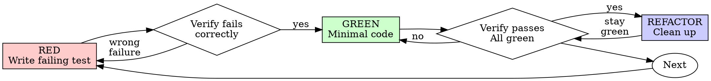

# Test-Driven Development (TDD)

## Overview

Write the test first. Watch it fail. Write the least code that makes it
pass.

**Core principle:** if you never saw the test fail, you don't know that
it tests the right thing.

**Violating the letter of the rules is violating the spirit of the
rules.** Most shortcuts are argued for on spirit grounds, so the letter
is the part that holds.

## When to Use

**Always:**
- New features
- Bug fixes
- Refactoring
- Behavior changes

**Exceptions, only with your human partner's agreement:**
- Throwaway prototypes
- Generated code
- Configuration files

If you catch yourself thinking "just this once, I'll skip the test", you
are rationalizing. Check the table under Common Rationalizations before
you act on it.

## The Iron Law

```
NO PRODUCTION CODE WITHOUT A FAILING TEST FIRST
```

This applies to new behavior. If you wrote code for new behavior during
the current task before its test, delete that code and start again from
the test. Don't keep it as a reference, don't adapt it while you write
the test, and don't look at it. Code you can see shapes the test you
write, and the test ends up checking what the code does instead of what
it should do. Implement fresh from the test.

A test that can only come after the code is covered in the next section.

## Tests Written After the Code

Some tests can only come after the code:

- a regression guard for a bug that already shipped;
- a test a reviewer asked for after the fix was written;
- tests for existing code that has none.

You never saw these fail, so prove them with a mutant instead:

1. Make an isolated copy: a throwaway worktree or a copy of the
   directory. The real working tree stays untouched, so restoring can't
   lose work.
2. In the copy, put the defect back. For a regression guard, revert the
   fix. For untested code, break the guarantee the test claims to
   protect.
3. Run the test in the copy and confirm it fails.
4. Read the failure message. It must fail for the right reason, naming
   the broken behavior and the wrong value. A crash, a type error or a
   missing import is not the right reason.
5. Discard the copy and confirm the test passes against the real code.

If the test still passes with the defect back in, it does not guard
anything. Fix the test and repeat.

Never write RED/GREEN history that did not happen. A commit message,
report or PR description says "failed first, then passed" only when you
watched it fail before the code existed. For a test added afterward,
say that and name the mutant: "Reverting the fix makes this test fail
with `expected 'Email required', got undefined`."

This route is not a loophole for new behavior. Code for new behavior
that you write test-last within the current task still falls under the
Iron Law: delete it and start from the test.

## Red-Green-Refactor



### RED - Write Failing Test

Write one small test that shows what should happen.

<Good>
```typescript
test('retries failed operations 3 times', async () => {
  let attempts = 0;
  const operation = () => {
    attempts++;
    if (attempts < 3) throw new Error('fail');
    return 'success';
  };

  const result = await retryOperation(operation);

  expect(result).toBe('success');
  expect(attempts).toBe(3);
});
```
Clear name, tests real behavior, one thing
</Good>

<Bad>
```typescript
test('retry works', async () => {
  const mock = jest.fn()
    .mockRejectedValueOnce(new Error())
    .mockRejectedValueOnce(new Error())
    .mockResolvedValueOnce('success');
  await retryOperation(mock);
  expect(mock).toHaveBeenCalledTimes(3);
});
```
Vague name, tests mock not code
</Bad>

**Requirements:**
- One behavior per test.
- A name that says what the behavior is.
- Real code. Use a mock only when nothing else will do; usually you can
  pass a simple value instead (see When Stuck).

### Verify RED - Watch It Fail

Never skip this step. It is the only evidence that the test can catch
the bug.

```bash
npm test path/to/test.test.ts
```

Confirm that:
- the test fails, rather than erroring;
- the failure message is the one you expected;
- it fails because the feature is missing, not because of a typo.

**If the test passes,** it is testing behavior that already exists. Fix
the test.

**If the test errors,** fix the error and re-run until it fails for the
right reason.

### GREEN - Minimal Code

Write the simplest code that passes the test.

<Good>
```typescript
async function retryOperation<T>(fn: () => Promise<T>): Promise<T> {
  for (let i = 0; i < 3; i++) {
    try {
      return await fn();
    } catch (e) {
      if (i === 2) throw e;
    }
  }
  throw new Error('unreachable');
}
```
Just enough to pass
</Good>

<Bad>
```typescript
async function retryOperation<T>(
  fn: () => Promise<T>,
  options?: {
    maxRetries?: number;
    backoff?: 'linear' | 'exponential';
    onRetry?: (attempt: number) => void;
  }
): Promise<T> {
  // YAGNI
}
```
Over-engineered
</Bad>

Don't add features, refactor other code or make improvements the test
doesn't ask for.

### Verify GREEN - Watch It Pass

This step is required too.

```bash
npm test path/to/test.test.ts
```

Confirm that:
- the test passes;
- the other tests still pass;
- the output is clean, with no errors or warnings.

**If the test fails,** fix the code, not the test.

**If other tests fail,** fix them now.

"Other tests" means the project's whole suite, not just your file. A
green run of the test you wrote is not a green suite. Before you call
the change done, run the project's test command (bare `pytest`,
`npm test`, `cargo test`, whatever the repo uses), even when your task
named only one test file. A scope statement in your task bounds what you
deliver, not what you verify. Report every failure that run shows by
name, including ones you didn't cause. Leaving out a failure you saw
makes the report false.

### REFACTOR - Clean Up

Only after green:
- remove duplication;
- improve names;
- extract helpers.

Keep the tests green, and add no behavior.

### Repeat

Write the next failing test for the next piece of behavior.

## Good Tests

| Quality | Good | Bad |
|---------|------|-----|
| **Minimal** | One thing. "and" in the name? Split it. | `test('validates email and domain and whitespace')` |
| **Clear** | The name describes the behavior | `test('test1')` |
| **Shows intent** | Demonstrates the API you want | Obscures what the code should do |

When writing or changing any test, read
[writing-good-tests.md](writing-good-tests.md). It covers the rules that
keep tests honest:
- name the production change that would make the test fail, before
  writing it;
- assert on real behavior, never on mock behavior;
- pass simple values (a stopped clock, a buffer sink, an in-memory
  store) instead of mocking the code under test;
- keep test-only code in test utilities, out of production classes;
- learn a dependency's side effects before mocking it;
- catch vacuous tests: preconditions that go unchecked, values that
  collapse, operands too weak to tell laws apart, and harnesses nobody
  mutated.

## Common Rationalizations

| Excuse | Reality |
|--------|---------|
| "Too simple to test" | Simple code breaks, and the test takes 30 seconds. |
| "I'll test after" | A test written after the code passes at once, which proves nothing. It may test the wrong thing, test the implementation instead of the behavior, or miss the edge case you forgot. Until you see it fail, you don't know it can catch the bug. For new behavior, write the test first. For a test that can only come after, prove it with a mutant. |
| "Tests after achieve same goals (spirit not ritual)" | Tests written after answer "what does this do?" Tests written first answer "what should this do?" The code you already wrote biases the tests that follow it: you check the cases you remembered, not the ones you would have found. You get coverage with no proof that the tests work. |
| "Already manually tested" | Manual testing is ad hoc. It leaves no record of what you covered, it can't be re-run when the code changes, and cases slip under pressure. "It worked when I tried it" is not coverage. An automated test runs the same way every time. |
| "Deleting X hours is wasteful" | That is the sunk-cost fallacy: the time is spent either way. The real choice is between rewriting test-first, with high confidence, and keeping code you can't trust with tests bolted on. Keeping it is the waste. |
| "Keep as reference, write tests first" | You'll adapt it, and that is testing after. Delete it. |
| "Need to explore first" | Fine. Throw the exploration away and start test-first. |
| "Test hard = design unclear" | Listen to the test. Code that is hard to test is hard to use. |
| "TDD will slow me down" | TDD is the pragmatic path. It catches bugs before commit, prevents regressions and lets you refactor without fear. The "pragmatic" shortcut means debugging in production, which is slower. |
| "Manual test faster" | A manual test doesn't prove the edge cases, and you'll repeat it after every change. |
| "Existing code has no tests" | You're improving it, so add tests for it, and prove each one with a mutant: break the behavior in an isolated copy and watch the test fail. |
| "I'll write it up as red then green" | Only if it happened. Record a test added afterward as that, and name the mutant that proved it. |

## Red Flags - Stop and Start Over

- Code before test
- Test after implementation
- Test passes immediately
- Can't explain why test failed
- Tests added "later"
- Rationalizing "just this once"
- "I already manually tested it"
- "Tests after achieve the same purpose"
- "It's about spirit not ritual"
- "Keep as reference" or "adapt existing code"
- "Already spent X hours, deleting is wasteful"
- "TDD is dogmatic, I'm being pragmatic"
- "This is different because..."
- A regression test nobody has run against the restored defect
- A report that says "failed first" about a test written afterward

For new behavior written in this task, each of these means: delete the
code and start over from the test. For a test that can only come after
the code, it means: prove the test with a mutant before you rely on it.

## Example: Bug Fix

**Bug:** Empty email accepted

**RED**
```typescript
test('rejects empty email', async () => {
  const result = await submitForm({ email: '' });
  expect(result.error).toBe('Email required');
});
```

**Verify RED**
```bash
$ npm test
FAIL: expected 'Email required', got undefined
```

**GREEN**
```typescript
function submitForm(data: FormData) {
  if (!data.email?.trim()) {
    return { error: 'Email required' };
  }
  // ...
}
```

**Verify GREEN**
```bash
$ npm test
PASS
```

**REFACTOR**
Extract validation for multiple fields if needed.

If the fix had already been written when you added this test, you would
instead revert the `if` in an isolated copy, run the test, and expect
the same `FAIL: expected 'Email required', got undefined`.

## Verification Checklist

Before marking work complete:

- [ ] Every new function or method is covered by a test that fails
      when it breaks (trivial code through its consumers; see
      writing-good-tests.md, Your code, not the framework).
- [ ] You watched each new-behavior test fail before implementing it.
- [ ] Each test failed for the expected reason (feature missing, not a typo).
- [ ] Each test added after the code failed against a mutant, and you
      read the failure message.
- [ ] You wrote the least code that passes each test.
- [ ] All tests pass, across the project's suite.
- [ ] The output is clean, with no errors or warnings.
- [ ] Tests use real code, or simple values passed in; mocks only where unavoidable.
- [ ] Edge cases and errors are covered.
- [ ] Every RED/GREEN claim in your report or commit message happened.

If you can't check every box, you skipped part of TDD. Go back and do it.

## When Stuck

| Problem | Solution |
|---------|----------|
| Don't know how to test | Write the API you wish you had. Write the assertion first. Ask your human partner. |
| Test too complicated | The design is too complicated. Simplify the interface. |
| Must mock everything | The code is too coupled. Use dependency injection: let the code take its clock, output, store or network as a parameter, and have the test pass a different value, such as a stopped clock, a buffer sink or an in-memory store. Don't mock the code under test. |
| Test setup huge | Extract helpers. Still complex? Simplify the design. |

## Debugging Integration

Found a bug? Write a failing test that reproduces it, then follow the
cycle. The test proves the fix and guards against the bug coming back.

Never fix a bug without a test. If the fix came first, prove the test
with a mutant as described in Tests Written After the Code.

## Final Rule

```
Production code → test exists and failed first
Otherwise → not TDD
```

The one route around it is a test that can only come after the code,
proven by a mutant. Any other exception needs your human partner's
permission.
